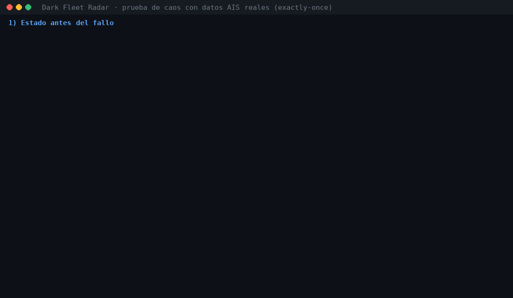

# Dark Fleet Radar

*[Leer en español](README.md)*

Real-time "dark fleet" radar: it ingests live AIS signals from ships, detects suspicious behaviour
(signal gaps, GPS spoofing, ship-to-ship meetings at sea, identity changes, sanctioned vessels) and
shows it on a map, with metrics that prove the alerts work.

## At a glance

| What | Result |
|---|---|
| Exactly-once | 0 duplicates and 0 gaps per Kafka offset in bronze, even after killing Flink mid-stream ([chaos test](#exactly-once-and-chaos-test)) |
| Detections | 6 streaming rules: spoofing, dark gaps, encounters at sea, loitering over undersea cables, sanctioned vessels and identity changes |
| Precision / recall | 100 % / 100 % on all 6 rules over 150 labelled vessels (positives and hard negatives) ([evaluation](#evaluation-precision-and-recall)) |
| Real data | Live Baltic and North Sea traffic: about 3,000 AIS messages per minute on a 16 GB PC |



## Architecture

```
aisstream.io (WebSocket, Baltic + North Sea)
        │
  producer/  ── validates, reconnects with backoff + jitter, key = MMSI
        │            ├─► data/raw/ais-YYYYMMDD-HH.jsonl   (recording for replay)
        │            └─► :8000/metrics                    (Prometheus)
        ▼
  Redpanda ── ais.raw (6 partitions, 7 days)   ais.dlq (invalid messages + reason)
        │
        ▼
  Flink SQL (flink/sql/pipeline.sql) ── event time, 1 min watermark,
        │                                exactly-once checkpoints every 60 s
        ▼
  Iceberg (REST catalog) on local S3 (SeaweedFS)
     ├─ ais.ais_raw                 bronze: every Kafka record once, with partition and offset
     ├─ ais.positions               silver: typed lat/lon/SOG/COG, quality flags, deduplicated
     ├─ ais.vessel_static_reports   silver: IMO, name, call sign, type, destination, draught
     │
     │  Second Flink job (flink/sql/detections.sql), same topic, separate consumer group
     │        └─ looks up OpenSanctions, ports, cables and coverage in Postgres (lookup joins)
     ├─ gold.coverage_h3            messages and vessels per H3 cell (resolution 7) per hour
     └─ gold.alerts                 one row per alert, with a score and JSON evidence
                │
                ▼
  Postgres (alerts and coverage) + Prometheus (metrics) ──► Grafana: map and pipeline health
```

aisstream has no SLA and no replay, so everything is persisted to Kafka and disk before processing.

## Running it

Requirements: Docker with about 6 GB of RAM (16 GB PC recommended) and a free
[aisstream.io](https://aisstream.io) API key.

```bash
cp .env.example .env          # then paste your AISSTREAM_API_KEY into .env
docker compose up -d --build
docker compose logs -f producer
```

- **Dashboard (Grafana): http://localhost:3000**: alert map, coverage, alerts by type and pipeline
  health. No login needed to view; `admin` / `admin` to edit.
- Flink (jobs, checkpoints, backpressure): http://localhost:8081
- Lake summary: `docker compose --profile tools run --rm tools summary`
- Redpanda console: http://localhost:8090 (change it with `CONSOLE_PORT` in `.env`)
- Producer metrics: http://localhost:8000/metrics
- Recordings: `data/raw/`, which you can explore with [DuckDB](https://duckdb.org): `duckdb -c ".read scripts/explore.sql"`

To change region, edit `AIS_BOUNDING_BOXES` in `.env`; for example, the Colombian Caribbean and the
Panama Canal approach: `[[[7.0, -82.0], [13.5, -74.0]]]`.

## Exactly-once and chaos test

Flink stores Kafka offsets and state in every checkpoint (every 60 s), and Iceberg commits once per
checkpoint. If Flink crashes it resumes from the last checkpoint: anything not committed is read
again, and anything committed is not repeated.

The bronze table keeps each record's partition and offset, so this can be checked:
`docker compose --profile tools run --rm tools verify` confirms that no partition has repeated
offsets (duplicates) or jumps (losses).

Chaos test: `./scripts/chaos_test.sh` (or `.\scripts\chaos_test.ps1` on Windows) kills the
TaskManager mid-stream, shows both jobs going to `RESTARTING` and back to `RUNNING` from the last
checkpoint, waits for two new checkpoints and verifies again. That is the GIF at the top, run on
real Baltic and North Sea AIS data (long waits are fast-forwarded): the table grew from 1,137,192 to
1,146,508 rows during the test and still had 0 duplicates and 0 gaps across the 6 partitions.

**Design decision, local S3:** the original brief used MinIO, but MinIO stopped publishing images
on Docker Hub. Iceberg only needs an S3 API, so SeaweedFS (Apache 2.0) is used instead.

## Dashboard

Grafana (`infra/grafana/`) reads from two sources:
- **Postgres**: the detections job copies every alert from `gold.alerts` into the `alerts` table (a
  streaming read of the Iceberg table) and writes coverage per cell and hour to `coverage_hourly`.
- **Prometheus**: producer metrics (messages per minute, % to the DLQ, event delay) and Flink metrics
  (completed and failed checkpoints and their duration).

The dashboard is generated by `python infra/grafana/build_dashboard.py`; edit it there, not in the JSON.

## Detections

They run in a Flink job separate from ingestion, so rules can change without touching bronze/silver.
Each alert has a deterministic `alert_id` (hash of type, vessel and time), so an alert written twice
is recognised as the same one.

| Alert | Rule | Score |
|---|---|---|
| `spoofing_jump` | Two consecutive positions of the same MMSI would require more than 50 knots, with a jump over 2 km (no merchant ship goes much faster than 30 knots; the 2 km avoids mistaking GPS noise for a jump). One alert per episode: only the first jump after 6 h without jumps | speed / 100, max 1 |
| `sanctioned_vessel` | The IMO (with a valid check digit) or MMSI of a static report is on the [OpenSanctions](https://www.opensanctions.org/datasets/maritime/) maritime list. One alert per vessel, listing every source that names it | 1.0 if sanctioned, 0.7 for other risk |
| `identity_change` | Same IMO with a name or MMSI never seen before for that IMO, within 30 days (vessels that alternate between two spellings of their name don't alert every time) | 0.9 if the flag (MID) changes, 0.7 if the MMSI changes, 0.5 name only |
| `dark_gap` | A vessel goes silent for 2 hours or more outside port **and** in the middle hour of the silence 2 or more other vessels were heard in the same zone (H3 resolution 5 cell, about 250 km²). If nobody was heard, the silence may be a coverage gap and it doesn't alert | hours silent / 12, max 1 |
| `sts_encounter` | Two vessels under 2 knots (not moored), outside port, less than 1 km apart for at least 90 minutes of a 2 h window: a possible ship-to-ship transfer. Pairs are matched across neighbouring H3 cells, so drifting ships on either side of a border aren't missed. It doesn't count when the cell (~36 km²) has more than 4 stationary vessels: that is an anchorage or waiting area | 0.5 + minutes together / 240, max 1 |
| `cable_loitering` | A slow (< 3 knots) or anchored vessel spends 30 minutes or more of an hour (1 h windows sliding every 30 min) inside the ~3 km band of an undersea cable or pipeline, outside port. This is the pattern seen before the Balticconnector (2023) and Eagle S (2024) incidents | 0.4 + minutes / 100, max 1 |

Reference zones (`tools/src/radar_tools/geo.py`, stored as H3 cells in Postgres): 49 North Sea and
Baltic ports (about 10 km around each) and 9 cables and pipelines (Balticconnector, Estlink 1 and 2,
C-Lion1, Nord Stream, BCS, NordBalt, NorNed, North Sea Link). **Routes are approximate**, a few points
per cable; for serious use, load the real routes (e.g. from EMODnet).

When rules change, the detections job gets a new version (currently `dark-fleet-radar-detections-v4`):
`flink-job` cancels the previous version and the new one continues from the offsets it left in Kafka.

Custom Java functions (`flink/udf/`, compiled and self-tested when the image is built): `h3_cell`,
`h3_disk` (a cell and its neighbours), `haversine_km`, `implied_speed_kn`, `imo_valid` and `epoch_ms`.

See the alerts (count per type and the 20 most recent):
`docker compose --profile tools run --rm tools alerts`

**Technical notes (Flink 1.20):**
- The sql-client fails ("belongs to a different planner") with temporary views that call custom
  functions or do lookup joins, so JSON fields are computed columns on the source table and each
  query is written out in full inside its `INSERT`.
- The `TUMBLE` TVF doesn't accept a subquery with a lookup join, and applying it before the join
  turns the aggregation into one that emits retractions (which append-mode Iceberg rejects).
  Encounters and cables use classic group windows (`GROUP BY TUMBLE(...)` / `HOP(...)`), and vessel
  pairs are built with an interval join on the window time.

## Evaluation: precision and recall

Real data has no labels, so you can't directly measure how many alerts are correct. What you can
measure is whether each rule does what it says: `tools evaluate` (`tools/src/radar_tools/evaluate.py`)
builds 12 simulated hours of traffic with labelled cases, sends them to a separate topic
(`ais.eval`) and processes them with a Flink job running **the same detections SQL**
(`flink/evaluate.sh` only swaps the topic and the output tables, suffixed `_eval`). It then compares
the alerts against the labels.

Each type has 12 positive cases and 12 hard negatives that look like a positive but must not alert:

| Alert | Positives | Hard negatives |
|---|---|---|
| `spoofing_jump` | One report displaced 90 to 330 km for one minute | 35 kn ferry, ~1 km GPS noise, 30 min without reporting |
| `dark_gap` | 2.5 to 6 h silence with other vessels heard nearby | 1.5 h silence, silence where nobody is heard, silence in port |
| `sts_encounter` | Two vessels 0.1–0.8 km apart under 1.5 kn for 3 to 5 h | 2.5 km apart, in port, only 60 min, 9 kn convoy, anchorage with 9 ships |
| `cable_loitering` | Slow vessel over a cable for 45 to 120 min | Crossing at 10 kn, only 20 min, slow but far from any cable |
| `sanctioned_vessel` | IMO from the loaded list (2 in the sample list) | Valid IMO not on the list |
| `identity_change` | Same IMO with another MMSI and flag | Same identity throughout, same name with different case and spacing |

Result (`reports/evaluation.md`):

| Alert | Positives | Hard negatives | Precision | Recall | Alerts per case |
|---|---|---|---|---|---|
| `spoofing_jump` | 12 | 12 | 100 % | 100 % | 1.0 |
| `dark_gap` | 12 | 12 | 100 % | 100 % | 1.0 |
| `sts_encounter` | 12 | 28 | 100 % | 100 % | 1.6 |
| `cable_loitering` | 12 | 12 | 100 % | 100 % | 2.5 |
| `sanctioned_vessel` | 2 | 12 | 100 % | 100 % | 1.0 |
| `identity_change` | 12 | 12 | 100 % | 100 % | 1.0 |

Encounter negatives are counted per vessel: each anchorage contributes 9.

The evaluation paid off: the first run gave 0 % recall on dark gaps and 17 % on encounters. What was fixed:
- **Dark gaps:** coverage was checked in the same H3 resolution 7 cell (~5 km²), and at open sea
  another ship is almost never in such a small cell in the same hour. It now uses the zone
  (resolution 5, ~250 km²).
- **Encounters:** pairs were only formed when both ships were in the same cell, and drifting ships
  cross borders all the time. They are now matched across the cell and its neighbours (`h3_disk`).
- **Anchorages:** on real data, thousands of "encounters" came from waiting areas off the coast where
  dozens of ships anchor together. Now a cell with more than 4 stationary vessels doesn't alert. The
  trade-off: a real transfer inside a busy anchorage doesn't alert either.
- **Cables:** with fixed 1 h windows, a vessel loitering 54 minutes split across two hours didn't
  alert. Windows now slide every 30 minutes.
- **Generator:** one negative showed up as a false alarm because two cases shared the same random
  IMO. Generated IMOs are now unique.

"Alerts per case" above 1 is expected for encounters and cables: they alert once per window while
the pattern lasts. A 100 % here means each rule does what it says on these cases, not that it is
always right on real data.

To run it (with the stack up; about 15 minutes, real data untouched): `./scripts/evaluate.sh` or
`.\scripts\evaluate.ps1` on Windows.

## The producer

| Topic | Decision |
|---|---|
| Reconnection | Exponential backoff with full jitter (1 s to 60 s); resets after 60 s stable |
| Fast reads | `send()` only enqueues into the Kafka buffer and never blocks the WebSocket (aisstream drops slow readers) |
| Duplicates | Idempotent producer with `acks=all` |
| Partitioning | Key = MMSI, so all messages of a vessel stay ordered in the same partition |
| Validation | Broken JSON, missing fields, unreadable time and non-ship MMSIs (outside 2xx–7xx or fillers like 123456789) go to the DLQ |
| Position quality | Lat 91 / lon 181 and impossible jumps are **not** dropped here; Flink flags them |
| Recording | Every raw frame, invalid ones included, as JSONL per UTC hour |

## Development

```bash
cd producer            # or cd tools
python -m venv .venv && source .venv/bin/activate
pip install -r requirements-dev.txt
pytest -q && ruff check .
```

## Known limitations

- **AIS coverage:** aisstream aggregates land-based receivers. Far from the coast there are holes, and
  a dark gap there can't be told apart from missing coverage (which is why the rule requires it).
- **Approximate zones:** cable routes and port zones use few points. A transfer inside a busy
  anchorage doesn't alert either, because of the density filter.
- **Synthetic evaluation:** the 100 % measures that each rule does what it says on constructed cases,
  not real-world precision, where there are no labels.
- **Single node:** everything runs in Docker on one PC. Flink, Redpanda and the catalog (SQLite) run
  with parallelism 1 and no high availability.

## Ethics and licences

Non-commercial use. Alerts are signals to prioritise a review, never proof of wrongdoing. No personal
data enrichment. The API key lives only in `.env`, which is in `.gitignore`. Code under the MIT licence.
